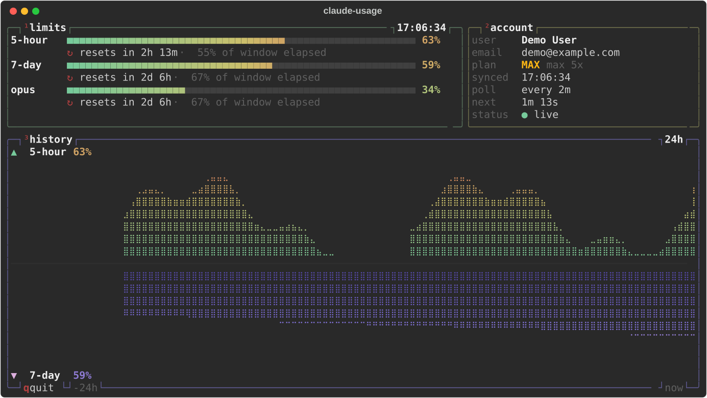

# claude-usage: btop edition

A full-screen terminal dashboard for your **Claude Code plan limits**, styled
after [btop](https://github.com/aristocratos/btop). It shows how much of your
5-hour and 7-day limits you've used, when they reset, and a 24-hour history
graph, without you needing to run `/usage` or open a browser.



This is a fork of
[LightspeedDMS/claude-usage](https://github.com/LightspeedDMS/claude-usage)
by jsbattig (MIT licence). The original tool does the hard parts: reading
Claude Code's login and talking to the usage API. This fork adds a new default
screen and a gentler, more transparent way of polling the API. The original
layout is still there with `--classic`.

---

## Contents

- [Install](#install)
- [Use](#use)
- [What's on the screen](#whats-on-the-screen)
- [How it polls (and why)](#how-it-polls-and-why)
- [What changed from the original](#what-changed-from-the-original)
- [Privacy: what it reads, stores and sends](#privacy-what-it-reads-stores-and-sends)
- [Caveats](#caveats)
- [Troubleshooting](#troubleshooting)
- [For developers](#for-developers)
- [Credits and licence](#credits-and-licence)

---

## Install

You need **Python 3.8+** and **Claude Code installed and logged in** (the
monitor uses the same login). It has been developed and tested on Linux with
Python 3.12.

The easiest way is [pipx](https://pipx.pypa.io/), which installs command-line
tools in their own isolated environment:

```bash
pipx install git+https://github.com/foxhats/claude-usage.git
```

Or with plain pip:

```bash
pip install git+https://github.com/foxhats/claude-usage.git
```

To update later:

```bash
pipx upgrade claude-usage        # if installed with pipx
pip install -U git+https://github.com/foxhats/claude-usage.git   # pip
```

> If you already have the original `claude-usage` installed, uninstall it first
> (`pipx uninstall claude-usage`). Both provide the same `claude-usage`
> command.

## Use

```bash
claude-usage             # btop-style screen (default)
claude-usage --classic   # the original layout
claude-usage --version
```

| Key | Action |
| --- | --- |
| `q` or `Ctrl+C` | quit |
| `↑` `↓` | scroll the event feed (only with pace-maker installed) |
| `←` `→` | switch pace-maker panel (only with pace-maker installed) |

**Exit codes:** `0` normal quit · `1` no Claude Code login found · `2` stopped
because the API kept rate-limiting it (see below).

## What's on the screen

| Box | Shows |
| --- | --- |
| **¹ limits** | One meter per active limit (5-hour, 7-day, and the per-model 7-day limits such as Opus or Sonnet when your plan has them). Under each: time until reset and how much of the window has gone by. If "% used" is well ahead of "% of window elapsed", you're on track to hit the limit early. |
| **² account** | Name, email, plan badge and tier, the time of the last successful sync, the current poll interval and a countdown to the next poll, and a status dot (green = live, red = error). |
| **³ history** | 24-hour braille graph. The 5-hour usage grows **up** from the middle line and the 7-day usage hangs **down** (like btop's network graph). Gaps mean the monitor wasn't running then. |
| **⁴ 7-day breakdown** | Only when the API provides it: which sources used how much of your weekly limit. |
| **error** | Appears only when the last poll failed, with the reason in plain words. |
| **⁵ pace-maker / ⁶ events** | Only if you use [Claude Pace Maker](https://github.com/LightspeedDMS/claude-pace-maker). It shows the same pace-maker panels as the original tool. |

The layout adapts to the terminal: on wide terminals (96+ columns) **limits**
and **account** sit side by side, and on narrow ones they stack. The history
graph stretches to fill whatever height is left.

## How it polls (and why)

The usage API is undocumented and rate-limited, and hammering it can get you
temporarily blocked. So the monitor follows a small, predictable policy:

1. **Every 2 minutes** it makes **one** request. It never retries in the
   background.
2. **If any request fails** (network error, expired login, rate limit,
   anything else), the error appears in a red box and polling slows to
   **every 4 minutes for the rest of the session**.
3. **If it gets rate-limited (HTTP 429) while already at 4 minutes**, it stops
   and prints a report so you can see what happened:

   ```
   claude-usage stopped: the usage API rate limited it (HTTP 429)
   while it was already polling every 4 minutes.

   What happened
     2026-11-05 14:02:11  started, polling every 2 min
     2026-11-05 15:40:13  49 successful poll(s)
     2026-11-05 15:40:13  poll failed: HTTP 429 Too Many Requests -> switched to every 4 min
     2026-11-05 15:44:13  poll failed: HTTP 429 Too Many Requests -> stopped

   Last request
     GET https://api.anthropic.com/api/oauth/usage
     status   429 Too Many Requests
     ...
   Response headers
     retry-after: 60
     set-cookie: <redacted>
     ...
   Response body
     ...
   ```

   Cookies are redacted, and your login token is never printed (it's only in
   the request, and the report shows the response).

If you use Claude Pace Maker, pace-maker already polls the API. This monitor
reads pace-maker's data first and only calls the API itself when pace-maker
has nothing for it (or skips the call while pace-maker is backing off).

## What changed from the original

| | Original | This fork |
| --- | --- | --- |
| **Default screen** | Single bordered panel with emoji labels | Full-screen btop-style layout with numbered boxes, gradient meters and btop's default colours (original still available via `--classic`) |
| **History** | None in the default view | 24-hour graph of 5-hour and 7-day usage, kept on disk for 7 days so it survives restarts |
| **Window progress** | Reset countdown only | Reset countdown plus "% of window elapsed", so you can see whether you're ahead of or behind pace |
| **Requests on a 429** | Up to **3 requests** per poll (retries after ~4 s and ~8 s), then exponential backoff | Exactly **1 request** per poll, never retried |
| **Screen during retries** | Freezes for up to ~12 s while it sleeps between retries | Never freezes; the display keeps refreshing every second |
| **Errors** | One-line message | Red error box in plain words, a status dot, the current poll interval shown on screen, and a full diagnostic report if it has to stop |
| **Poll interval** | 5 minutes | 2 minutes, dropping to 4 after any error |
| **Quit** | `Ctrl+C` | `q` or `Ctrl+C` |

Everything else, such as login handling, macOS Keychain support, console
(Admin API) mode and pace-maker integration, is unchanged from the original.

### Why it's better for everyday use

- **You can read it at a glance.** Most people only want "how close am I, and
  when does it reset?", and those are the biggest things on the screen.
- **You see trends, not just a number.** The history graph shows whether a
  spike was one heavy session or a steady climb.
- **It behaves well with the API.** One request at a time, a visible slowdown
  after errors and a hard stop on repeated rate limits mean it can't quietly
  get you rate-limited.
- **When something goes wrong, you can tell what.** It shows the HTTP status,
  the server's reason and the full response, instead of a vague "API error".
- **It works on its own.** The original's richest features need Claude Pace
  Maker. This view is useful with just Claude Code installed.

## Privacy: what it reads, stores and sends

- **Reads:** Claude Code's login from `~/.claude/.credentials.json` (on macOS,
  from the Keychain). It does not change your login, except for one thing
  inherited from the original: on macOS it re-syncs that file from the
  Keychain with owner-only permissions.
- **Sends:** requests only to `api.anthropic.com` (the usage and profile
  endpoints Claude Code itself uses). Nothing goes anywhere else. There's no
  telemetry.
- **Stores:** usage snapshots in `~/.claude-usage/usage_history.db` (a local
  SQLite file). The history graph uses the table `btop_util_history`, which
  holds only a timestamp and two percentages per sample, kept for 7 days.
  Delete the folder any time to reset.

## Caveats

- The usage API is **undocumented**. Anthropic can change or remove it at any
  time, which would break this tool (and the original) until it's updated.
- This is an unofficial community tool. It isn't made or endorsed by
  Anthropic.
- Console mode (`--mode console`, for organisation admins with an Admin API
  key) still uses the original layout. The btop view is for Code mode.
- Braille graphs and box-drawing characters need a font that has them. Most
  modern terminal fonts do.

## Troubleshooting

| Problem | Fix |
| --- | --- |
| `No credentials found` | Install Claude Code and log in by running `claude` once. |
| Red box mentions an expired token (`HTTP 401`) | Run `claude` to refresh your login. The monitor picks up the new token on the next poll. |
| Graph says "collecting history" | Normal on first run. It fills in as samples arrive, one per successful poll. |
| It stopped with a 429 report | The API is rate-limiting your account. Wait a while (check `retry-after` in the report) and start it again. |
| Boxes look broken or misaligned | Use a font with Unicode box-drawing and braille characters, and make the terminal wider. |
| Want the old look | `claude-usage --classic` |

## For developers

See **[docs/DEVELOPMENT.md](docs/DEVELOPMENT.md)** for a code map, how the
btop screen is built, the poll policy's state machine, how to add a new box,
how to run tests, and some project quirks (line endings, tests that were
already failing upstream).

The original project's full reference (API response formats, every pace-maker
panel, console mode) is kept in
[docs/UPSTREAM_README.md](docs/UPSTREAM_README.md).

## Credits and licence

- Original **claude-usage** by jsbattig /
  [LightspeedDMS](https://github.com/LightspeedDMS/claude-usage), MIT licence.
- The **btop edition** (the btop view, history graph, poll policy, error
  reports and these docs) was written by **Claude** (Anthropic's AI model)
  using Claude Code.
- Visual design and colours follow [btop](https://github.com/aristocratos/btop)'s
  default theme.

Released under the MIT licence. See [LICENSE](LICENSE).
